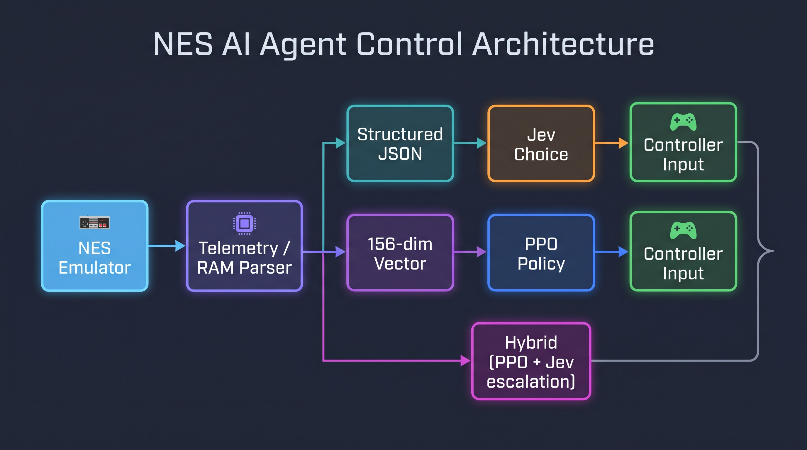

# TypeSafe Mario

An experimental controller that lets TypeSafe's Jev model—or a local Reinforcement
Learning (PPO) agent—directly choose NES controller inputs for the original Super
Mario Bros.

Neither controller receives screenshots. The harness translates emulator telemetry
and RAM into compact, object-centric state containing Mario's motion, jump trajectory,
upcoming enemies, terrain, measured response delay, recent-control results, and episode
progress. For Jev, this state is sent as structured JSON; for RL, it is encoded into a
bounded numeric vector. A controller action is chosen, the emulator advances several
frames, and the loop repeats. The raw local tile grid remains available in debug logs,
the UI, and the RL observation vector, while being omitted from the Jev JSON payload.

## Architecture



```text
NES emulator -> telemetry/RAM parser -> structured JSON -> Jev Choice -> controller input
                                     -> 156-dim vector  -> PPO Policy -> controller input
                                                        -> Hybrid (PPO + Jev escalation)
```

The initial action set is intentionally small:

- `noop`
- `right`
- `right_jump`
- `right_run`
- `right_run_jump`
- `jump`
- `left`

## Requirements

- Python 3.13 or newer
- A TypeSafe API key in `TYPESAFE_API_KEY` (required for `play` and `--hybrid` mode; not required for local RL)
- A legal local setup for Super Mario Bros.

This repository contains no Nintendo ROM or other copyrighted game data. You are
responsible for ensuring that your emulator and game files are obtained and used
lawfully.

## Setup

```powershell
py -3.13 -m venv .venv
.venv\Scripts\python -m pip install -e ".[mario,dev]"
$env:TYPESAFE_API_KEY = "your-key"
```

To include the Reinforcement Learning stack (PyTorch, Stable-Baselines3, TensorBoard),
install the `rl` extra as well:

```powershell
.venv\Scripts\python -m pip install -e ".[mario,rl,dev]"
```

Inspect the exact JSON and text that will be sent to TypeSafe without launching the
game or calling the API:

```powershell
.venv\Scripts\typesafe-mario state-demo
```

Run World 1-1 with Jev making a decision every eight emulator steps. The default
display is a single recordable window with the live game and model telemetry:

```powershell
.venv\Scripts\typesafe-mario play --env SuperMarioBros-1-1-v0 --frames-per-decision 8
```

The dashboard shows the selected action, full Choice probability distribution,
confidence, Jev latency, jump probability, danger score, reward, and parsed game
state. Press `R` or click **Restart** for a fresh episode; the dashboard remains open
after death or level completion. Press `Esc` or `Q` to quit. Use `--display game` for
only the emulator window or `--display none` for a headless benchmark.

Each decision is written to `artifacts/run-<timestamp>.jsonl`. These records include
latency, action probabilities, confidence, canonical model state, raw debug state, and
game outcome, providing the data for a live overlay or rendered social clip.

## What the parser produces

TypeSafe accepts JSON directly, so there is no need to flatten telemetry into prose.
The model-facing object groups observations by meaning:

- `player`: position, velocity, grounded state, jump phase, and power-up
- `trajectory`: airtime, distance since takeoff, and committed gap crossing
- `hazard`: up to three enemies, projected positions, contact timing, and takeoff deadline
- `terrain`: obstacle/gap geometry, observation reliability, and last grounded preview
- `reaction_timing`: action duration and measured observation-to-action delay
- `recent_control`: chosen action, duration, progress gained, and observed outcome
- `episode`: lives, clock, progress, stalls, death, and level completion

For humans, the fuller debug snapshot can still be rendered as compact text:

```text
Goal: Reach the flag in World 1-1 without dying.
Mario: x=172 y=79, moving right, airborne=False, status=small
Progress: 172 (best 172), time=387, lives=2
Nearby enemies: goomba 42px ahead
Local grid (# solid, . empty, E enemy, M Mario):
...........
...........
...........
..M..E.....
###########
```

The structured object is canonical; the text view is only for debugging and UI.

## TypeSafe judgments

Each request evaluates three independent judgments over the same state:

- a `Choice` selects the next controller macro;
- a `Noul` estimates whether a forward jump is useful now;
- a `Score` measures immediate danger for the live visualization.

Exact timing arithmetic stays in code. For example, the parser combines measured
response age, enemy motion, action cadence, and jump-clearance time into a typed
`jump_must_start_this_decision` fact. Jev interprets those facts and still owns the
controller choice—there is no scripted recovery-action override.

## Reinforcement Learning (PPO)

In addition to direct Jev control, `typesafe-mario` includes an offline RAM-based RL
pipeline built on Gymnasium and Stable-Baselines3 PPO (`256x256` MLP policy).

### Environment & observations

`MarioRLEnv` (single stage) and `MultiStageMarioEnv` (round-robin multi-stage) wrap
the same `MarioStateParser` telemetry and 7-action macro space used by Jev, adding
automatic A-button release frames when consecutive jump macros are issued while
grounded.

Each snapshot is encoded into a 156-dimensional `float32` vector in `[-1.0, 1.0]`:

- **Player & motion (20)**: position, velocity, grounded/airborne flags, jump phase, power-up status, airtime, jump distance, gap-crossing state, stall counter, and clock
- **Previous action (7)**: one-hot encoding of the last macro action
- **Terrain & navigation (12)**: obstacle/gap distances, heights/widths, forward clearance, and last grounded preview
- **Threat summary & enemies (18)**: takeoff urgency, contact horizon, closing speed, and up to 3 upcoming enemies
- **Local solid tile grid (99)**: flattened `9x11` binary solid-tile neighborhood around Mario

### Reward shaping

`MarioRewardCalculator` shapes step rewards using horizontal progress (with slightly
stronger backward penalty), new furthest-`x` bonuses, per-step and stall penalties, a
safe gap-crossing landing bonus, capped score-delta rewards, a death penalty, and a
stage-clear bonus.

### Behavior Cloning warm-start (`rl-bc`)

You can pretrain a PPO policy from recorded Jev JSONL logs in `artifacts/` before
running RL fine-tuning:

```powershell
.venv\Scripts\typesafe-mario rl-bc --inputs artifacts --model-path models/mario_bc.zip --epochs 30
```

Use `--min-confidence` to filter demonstrations by Jev's choice confidence.

### Training (`rl-train`)

Train a PPO agent in parallel across multiple emulator workers (checkpoints are saved
under `models/checkpoints/`, the best model as `<model>_best.zip`, and TensorBoard logs
under `runs/`):

```powershell
# Single stage (World 1-1)
.venv\Scripts\typesafe-mario rl-train --env SuperMarioBros-1-1-v0 --timesteps 1500000 --num-envs 8

# Resume / fine-tune from a Behavior Cloning or previous PPO checkpoint
.venv\Scripts\typesafe-mario rl-train --env SuperMarioBros-1-1-v0 --resume-from models/mario_bc.zip

# Multi-stage training across an entire world (e.g., 1-1 through 1-4) or explicit --envs list
.venv\Scripts\typesafe-mario rl-train --world 1 --model-path models/mario_world1_ppo.zip
```

Monitor training curves with TensorBoard:

```powershell
.venv\Scripts\tensorboard --logdir runs
```

### Evaluation (`rl-eval`)

Evaluate a trained model over multiple episodes (single stage, `--envs`, or `--world`)
and optionally export a JSON metrics report:

```powershell
.venv\Scripts\typesafe-mario rl-eval --model models/mario_ppo_best.zip --env SuperMarioBros-1-1-v0 --episodes 100 --output artifacts/eval_mario_ppo_best.json
```

### Playing & Hybrid mode (`rl-play`)

Watch a trained PPO policy play live in the telemetry dashboard (supports `--speed`,
`--display`, `--sound`/`--no-sound`, `--volume`, and `--stochastic`):

```powershell
.venv\Scripts\typesafe-mario rl-play --model models/mario_ppo_best.zip --env SuperMarioBros-1-1-v0
```

Enable **Hybrid mode** (`--hybrid`) to run local PPO for routine sub-millisecond
control and escalate to Jev only when RL confidence drops below `--confidence-threshold`
(default `0.55`), Mario stalls, or a missed-takeoff hazard is detected (subject to
cooldown and per-episode API budget):

```powershell
.venv\Scripts\typesafe-mario rl-play --model models/mario_ppo_best.zip --env SuperMarioBros-1-1-v0 --hybrid --confidence-threshold 0.55
```

## Development

```powershell
.venv\Scripts\ruff format --check src tests
.venv\Scripts\ruff check src tests
.venv\Scripts\python -m pytest -q
```
